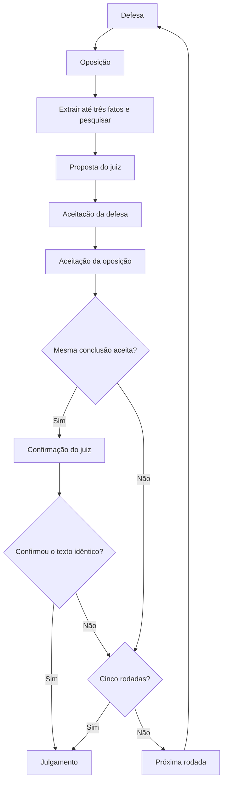

# Arquitetura e contratos

## Fluxo de uma audiência

1. React consulta saúde, catálogo gratuito e franquia diária.
2. `POST /api/matches` valida a pergunta e os quatro papéis, verifica franquia e catálogo, persiste a partida e inicia uma tarefa asyncio.
3. LangGraph executa os nós em sequência; cada evento é salvo antes de chegar ao stream customizado.
4. SSE lê SQLite a cada 250 ms. O navegador recebe eventos completos e ordena sua apresentação com `Playback`.
5. Consenso confirmado ou cinco rodadas levam ao julgamento; falhas preservam os eventos sem fabricar um resultado.



`DebateState` contém `round`, `proposal`, `acceptances` e `consensus`. O histórico durável fica em SQLite, sem checkpointer para retomar inferências. A comparação de conclusões é exata, sem normalização semântica. A média final é `(evidencias + coerencia + refutacoes) / 3`, arredondada a duas casas.

## Estados e tarefas

| Estado | Significado |
| --- | --- |
| `running` | Tarefa de debate ou demonstração iniciada. |
| `completed` | Resultado persistido. A leitura no navegador pode ainda estar em andamento. |
| `cancelled` | Usuário cancelou a execução; eventos anteriores permanecem. |
| `interrupted` | Erro de provedor/execução ou recuperação após reinício; sem resultado final. |

As tarefas vivem em um dicionário no processo. O lifespan recupera partidas antigas, cancela tarefas no encerramento e fecha clientes HTTP. Importar o módulo não executa a recuperação. Um único worker é necessário. Abrir o histórico/rever uma audiência reproduz dados; não reinicia as chamadas da partida.

## API REST

A base é `/api`. Corpos e respostas usam JSON, exceto SSE e relatório Markdown. FastAPI oferece os schemas completos em `/docs` e `/openapi.json`.

| Método/caminho | Entrada e resposta |
| --- | --- |
| `GET /health` | `ok`, `openrouter_configured`, `tavily_configured`; só presença das chaves. Não testa disponibilidade de cada serviço. |
| `GET /models` | `{models: [...]}` com IDs, nomes, parâmetros suportados e metadados de geração dos modelos gratuitos. Pode responder 503. |
| `GET /limits` | `{daily: {used, limit, remaining} ou null, reset_at: ISO ou null}`. Renovação estimada à próxima meia-noite UTC. `null` indica contador não fornecido, não franquia ilimitada confirmada. |
| `POST /matches` | `question` (8–2.000 caracteres), `models` com exatamente `defesa`, `oposicao`, `verificador`, `juiz`. Retorna partida em 201. Cota diária zero responde 429 antes de criá-la; configuração indisponível 503; validação/modelo inválido 422. |
| `POST /demo` | Sem corpo; retorna partida editorial em 201, sem APIs. |
| `GET /matches` | Até 100 partidas, recentes primeiro. |
| `GET /matches/{id}` | Partida acrescida de `events`; 404 para ID inexistente. |
| `POST /matches/{id}/cancel` | Sem corpo; cancela tarefa ativa e retorna partida. Estado terminal não é reaberto. |
| `GET /matches/{id}/events` | SSE; query `after` e cabeçalho `Last-Event-ID` retomam após o maior cursor válido. Cabeçalho inválido retorna 400. |
| `GET /matches/{id}/report` | Markdown UTF-8 com `Content-Disposition` para download. Inclui progresso sem julgamento quando necessário. |

Exemplo de corpo (substitua os IDs pelo catálogo atual; não são modelos garantidos):

```json
{
  "question": "A semana de trabalho de quatro dias deve ser adotada?",
  "models": {
    "defesa": "id-gratuito-selecionado",
    "oposicao": "id-gratuito-selecionado",
    "verificador": "id-gratuito-selecionado",
    "juiz": "id-gratuito-selecionado"
  }
}
```

## Eventos e reconexão

Um evento salvo é `{id, type, data}`; `id` é sequencial por partida, não global. O SSE usa esse ID no campo `id:` e o evento JSON em `data:`. Comentários heartbeat são enviados aproximadamente a cada dez segundos sem encerramento. A conexão fecha após enviar os eventos terminais restantes. O frontend usa o último cursor e deduplica IDs.

| Tipo | Conteúdo principal |
| --- | --- |
| `started` | Mensagem e indicador de demonstração. |
| `stage` | Papel, rodada e fase: `debate`, `pesquisa`, `proposta`, `aceitacao`, `confirmacao`, `julgamento`. |
| `model` | Papel/rodada e IDs `requested` e `actual`. Extrações sem fala também registram identidade. |
| `speech` | Papel, rodada, fase e texto validado; campos adicionais dependem do schema da etapa. |
| `evidence` | Afirmação, autor, rodada, classificação, explicação, IDs relevantes e fontes associadas. |
| `warning` | Problema de pesquisa; mensagem e, quando fornecidos, código/detalhes. O debate continua com inconclusão. |
| `result` | Julgamento, notas, médias, consenso, rodadas, divergências e contraditas. |
| `cancelled` / `interrupted` | Motivo de encerramento; erros de provedor incluem código/detalhes seguros. Recuperação após reinício pode ter apenas mensagem. |

O payload completo de uma fala é validado antes de ser persistido. SSE é streaming de **eventos**, não de tokens da resposta do modelo. A revelação de texto na tela começa após essa validação.

## SQLite

| Tabela | Dados e invariantes |
| --- | --- |
| `matches` | UUID, pergunta, JSON dos modelos, estado, indicador demo, criação UTC e resultado opcional. |
| `events` | Chave `(match_id, seq)`, tipo e payload JSON. Sequência obtida em transação `BEGIN IMMEDIATE`. |
| `search_cache` | Consulta normalizada, resultados e data UTC. Validade de 24 horas. |
| `budget` | Mês `YYYY-MM` UTC e quantidade de buscas reservadas. Reserva atômica; não estorna tentativas incertas. |

O banco usa WAL e conexões por operação. Não há exclusão automática, migração de schema, isolamento entre usuários ou autenticação. Dados locais podem conter conteúdo pessoal fornecido nas perguntas; mantenha-os fora do repositório.

## Integrações e limites

OpenRouter reconsulta preços antes de cada chamada, exige saída textual e taxas declaradas zero, bloqueia o roteador genérico `openrouter/free` e envia `max_price` zero/`allow_fallbacks: false`. A identidade retornada deve corresponder à selecionada, permitindo omissão de `:free`. Até três tentativas tratam rede, 5xx, JSON inválido e saída vazia. Limites 402/429 interrompem imediatamente. Raciocínio opcional é desativado quando permitido; obrigatório usa uma configuração compatível. Saída vazia/truncada pode aumentar o orçamento de tokens até o teto do modelo.

Franquia diária é diferente de limite de gastos da chave. A verificação antes da partida é preventiva, não reserva chamadas para toda a audiência: outras execuções e serviços da conta podem consumir a mesma cota. `provider_daily_limit` identifica esgotamento diário; `provider_rate_limit`, limites de capacidade/requisições não identificados como diários. Não há troca automática de modelo.

Tavily consulta `/usage` antes de cada busca não armazenada, exige plano gratuito (`free` ou `researcher`), consumo pago zero e pelo menos um crédito inteiro dentro da franquia e do orçamento local (máximo 1.000). `paygo_limit: null` só é aceito com esses dados confirmados; não é convertido em autorização de cobrança. Valores conhecidos de cobrança habilitada bloqueiam a busca. A requisição é `basic`, sem parâmetros automáticos, até três resultados, sem resposta pronta nem conteúdo bruto. O orçamento local é reservado antes do POST; falhas não repetem o POST.

O verificador recebe trechos limitados a 2.500 caracteres por fonte. Fontes têm URLs HTTP(S), mas isso não comprova confiabilidade. Classificação sem IDs válidos ou confirmação/contradição sem fonte é rebaixada a inconclusiva. Opiniões não são fatos; ausência de pesquisa não comprova contradição.

## Pontos de extensão

- Papéis/regras: altere schemas e grafo juntos, atualizando frontend, prompts e testes de encerramento.
- Provedor de LLM: implemente `models()` e `complete(model, system, context, schema)`; retorne dados validados e identidade real. `limits()` é opcional para provedores injetados.
- Pesquisa: implemente `search(query)` e levante `SearchUnavailable` para falhas recuperáveis.
- Persistência: preserve sequência/replay e trate migração antes de alterar tabelas.
- Apresentação: mantenha os eventos completos separados do texto parcial e preserve acessibilidade/redução de movimento.

Os contratos descrevem a versão atual. Não há hospedagem, login, Supabase, busca vetorial ou retomada de inferência nesta implementação.
